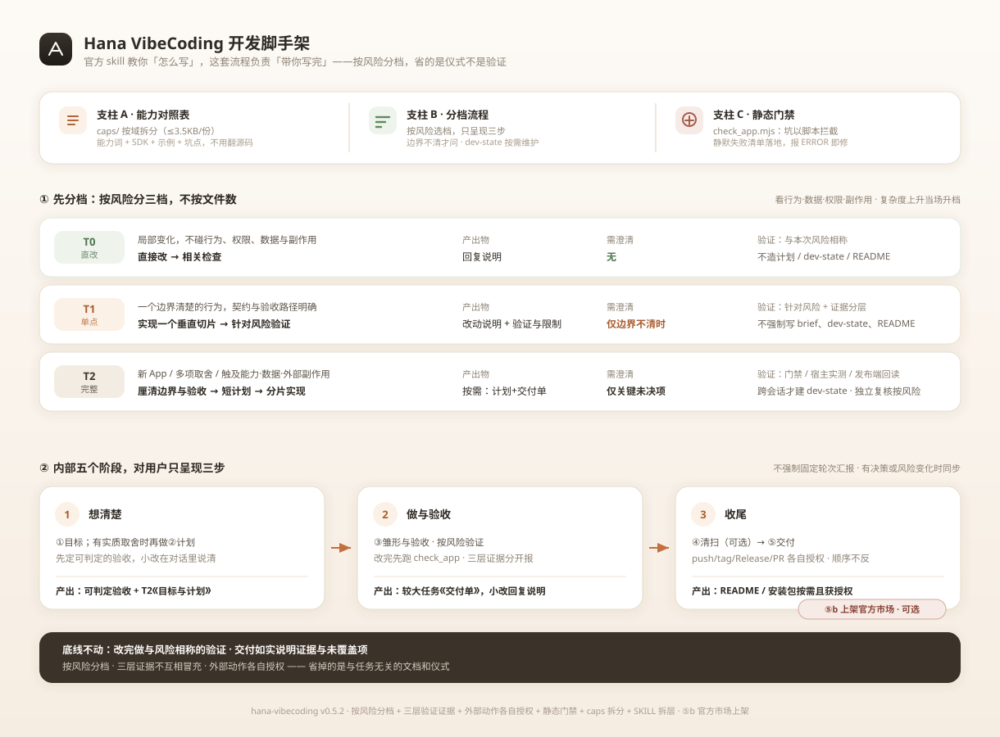
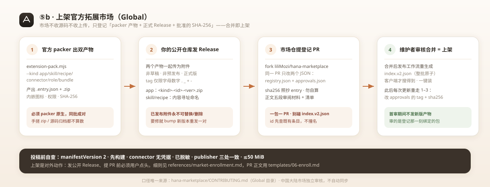
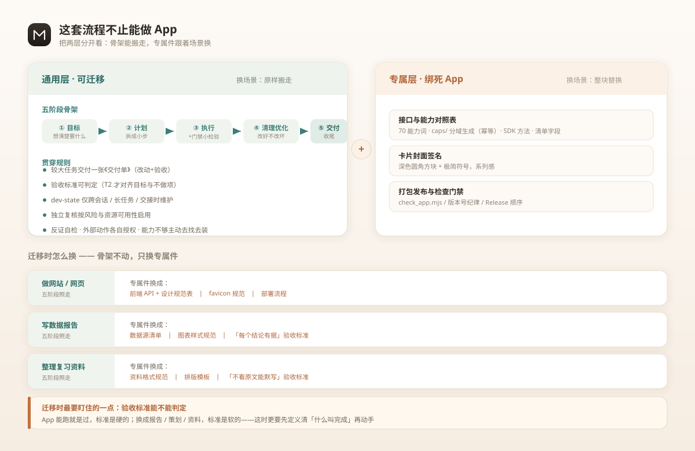

# Hana VibeCoding 开发脚手架（hana-vibecoding）

> 面向 vibe coding 的 Hana App 开发脚手架：**官方 skill 教你「怎么写」，这里负责「带你写完」。**

> **Codex 通用全栈适配版：** [outputs/codex-vibecoding/](outputs/codex-vibecoding/) 是独立的 Codex Agent Skill，包含分档流程、全栈工作流与检查表、技能生态索引、自带 SVG 资料图和行为评估；不含 Hana App / 扩展市场专属步骤。两套入口保持独立，Hana 源码也会借鉴其风险分流、验证和授权边界持续改进。



## 这是什么

一个给 [HanaAgent](https://github.com/liliMozi/openhanako) 用的 **skill（技能包）**，让不懂代码、靠说话让 AI 写 App 的人也能把 Hana App 做出来。解决两个实际痛点：

1. **AI 找不到接口**——权限开了，AI 却要自己翻源码才知道能调什么、怎么调。
   → 附一份《接口与能力对照表》，按"我要做 X"组织，AI 拿着直接调。

2. **开发容易跑偏**——边想边写、需求模糊、做完不收尾。
   → 一套**按风险分档**流程陪着走：小活小走，大活补足契约与验收；每步有必要的检查，但不为流程产出流程文档。

3. **坑靠文档防不住**——静默失败清单再全，也得靠"模型记得读"才生效。
   → `scripts/check_app.mjs` 静态门禁：把实测坑清单变成一条命令，改完就拦，ERROR 即修。

**Hana 原版定位**：补充官方 `hana-app-creator`，**不替代、不重复**。官方那份是技术规格字典（573 行 SKILL.md + 3022 行 APPS.md），凡是它已写清的，本套只链接过去。Codex 通用版见下文。

## 两个入口

### 入口 A · 接口与能力对照表

按"我想做的事"查，而不是按字母排：

| 我想… | 关键能力词 |
|---|---|
| 让 AI 在对话里调用我的功能 | `app/tools.expose-to-model` |
| 给用户一个能点的界面 | `app/ui.*` |
| 存数据 / 读写文件 | `app/resources.read/write` |
| 起子进程、联网、发通知 | `app/process.spawn` / `contributes.network` / `app/notifications.show` |
| 参与会话与拦截 | `app/hooks.*` |
| 开后端路由 / 原生窗口 / 输入面板 | — |

每个条目给出：**能力词、对应 SDK 方法、声明位置、最小示例、坑点**。所有方法名都核对过源码。

### 入口 B · 分档开发流程（配方法论）

**先分档，再谈流程**——以行为、数据、权限和副作用判断任务，不按文件数或固定轮次套模板：

| 档 | 按风险判断 | 走法 | 默认产出 |
|---|---|---|---|
| **T0 直改** | 文案、样式等局部变化，不改变行为、权限、数据或外部副作用 | 直接改 → 相关检查 | 回复说明；不造计划文档 |
| **T1 单点** | 一个边界清楚的 App 行为，契约和验收路径明确 | 一个垂直切片 → 针对风险验证 | 回复说明改动、验证与限制 |
| **T2 完整** | 新 App、多项取舍，或触及未厘清的能力/权限、数据归属/迁移、外部集成与副作用 | 先厘清边界和验收 → 短计划 → 分片实现与验证 | 按需使用 brief、跨会话状态和交付单 |

按实际风险升降档；简单任务直接做，关键边界不清时才询问。内部保留五个阶段名，**对用户只呈现三步**：

| 三步 | 含哪些阶段 | 产出 |
|---|---|---|
| **1 定结果** | ①目标；有实质取舍时再做②计划 | 简单任务在对话中界定结果；T2 按需记录目标与计划 |
| **2 做与验证** | ③雏形与验收 | 按风险运行检查；较大任务用交付单记录证据 |
| **3 交付** | ④清扫（可选）→ ⑤交付 → ⑤b市场投稿（可选） | 报告改动、实际检查、未覆盖项；README / Release / 投稿按需且获授权 |

**省掉的是与任务无关的文档和仪式，不是必要的安全与验证。**小修改不需要计划、状态文件、README 或独立审查；静态门禁、宿主实测和发布端回读分别报告，不互相冒充。

### ⑤b · 上架官方拓展市场（可选，用户点名才进）

做完的东西怎么让所有 Hana 用户一键装到？跟着这套流程走一遍官方 Global 市场（`liliMozi/hana-marketplace`）的四步闭环——**不收源码不收上传，只登记「官方 packer 产物 + 正式 Release + 审核批准的 SHA-256」**：



- 六种 kind（app / skill / recipe / connector / role / bundle）的命名差异、packer 定位与命令、预检脚本、PR 审阅材料五段、更新纪律，全在 `references/market-enrollment.md`；另附八条实战铁律（手搓 zip 不算数、bump 优于修补、打包非确定性、审核期不发新包……都是真踩过的坑）。
- 登记 PR 正文用 `templates/06-enroll.md` 填空，对着官方模板五段+检查清单逐项可核。
- 上架前可做本地预检；推送、公开 Release、市场 PR 是不同对外动作。完整列明动作和目标的投稿计划可一次授权，目标或产物变化后重新确认；上架完成以市场 workflow 和索引回读为准。

## 方法论从哪来

`references/methods.md` 是一份**方法论库**，吸收了 [Qoder](https://qoder.com) 那批开发类 skill 的精华，翻译成 Hana App 的语境：

| 来源 | 吸收了什么 | 挂在哪 |
|---|---|---|
| `create-plan` | story 拆分标准（fits-one-run + demo 边界） | 阶段② |
| `systematic-debugging` | 根因调查四阶段 + 反复失败时的止损信号 | 阶段③ |
| `requesting-code-review` | 独立审查（按风险启用，只给产物+需求） | 阶段③ |
| `analyze-code` | 代码原则 P1–P10 + 五级定级 | 阶段④ |
| `architecting` / `architecture-documenter` | 分层顺序、该拆的硬阈值、ADR 四段 | 阶段②④ |
| `ui-designer` / `frontend-design` / `stepfun-design` / `web-design-pro` | 设计系统骨架、反 AI 味清单、Token 三层、硬指标 | 阶段①③ |
| `git-commit` | 提交范围、仓库约定、双轨语言 | 阶段③⑤ |
| `self-improving-agent` | 经验沉淀触发清单、三层晋升 | 贯穿 |
| `ppt-visual-designer` | 信息组织三步（降维/飞轮/对比） | 阶段⑤ |
| `Writing-Skills` | 给 skill 做 TDD（RED-GREEN-REFACTOR） | 元方法 |

> 不是照搬文件，是**提炼要点、翻译语境**。安全与数据等边界保持明确，流程文档和审查则按风险启用，避免小改也背负完整仪式。

## 这套流程不止能做 App



五阶段骨架不是"App 开发流程"，而是**"把一个模糊想法做成可验收交付物"的通用节拍**。分两层看：

- **通用层（可迁移）**：五阶段骨架 + 贯穿规则 + `methods.md` 全部方法论——**换场景原样搬走**。
- **专属层（绑死 App）**：能力对照表、封面签名、打包发布纪律——**换场景整块替换**。

例如：做网站 → 专属件换成"前端 API + 设计规范"；写报告 → 换成"数据源清单 + 每个结论有据"；整理复习资料 → 换成"排版模板 + 不看原文能默写"。

**迁移时最要盯住的一点：验收标准能不能判定。** App 能跑就是过，标准是硬的；换成报告 / 策划 / 资料，标准是软的——这时更要先定义清"什么叫完成"再动手。

Hana 原版继续专注 App 技术规格、静态门禁和 Hana 市场流程；通用全栈流程已独立适配为 Codex skill，详见 [`outputs/codex-vibecoding/`](outputs/codex-vibecoding/README.md)。两者不共享运行时专属要求。

## Codex 通用全栈版

[打开独立 skill 包](outputs/codex-vibecoding/README.md) · [下载/浏览打包目录](outputs/codex-vibecoding.zip) · [分档工作流图](outputs/codex-vibecoding/assets/vibecoding-flow.svg) · [全栈信任边界图](outputs/codex-vibecoding/assets/fullstack-map.svg) · [质量门图](outputs/codex-vibecoding/assets/quality-gates.svg)

Codex 版针对从 idea 到可验证交付，覆盖 UI/UX、前端状态、API 契约、服务端授权、数据库和迁移、测试、浏览器验收、系统化调试与交付。它按风险分 T0/T1/T2，不要求每个小修改都出计划文档；没有 Hana App、拓展市场、扩展安装或打包规则。优质第三方 skill 以经核实的官方链接和适用场景索引，不复制其全文，也不强迫安装。

## 目录结构

```
hana-vibecoding/
├── docs/
│   ├── flow.svg            # 三大支柱：能力对照表 + 分档流程 + 三步视图（含 ⑤b 徒章）
│   ├── enroll.svg          # ⑤b 上架官方市场：四步闭环图
│   └── layers.svg          # 通用层 / 专属层 分层图
├── skill/hana-vibecoding/  # ← 可直接安装的 skill 包（自包含）
│   ├── SKILL.md            # 决策核：分档表/通过清单/贯穿规则（v0.5 起只留决策表，详文外移）
│   ├── references/
│   │   ├── capability-map.md    # 任务导向的接口与能力对照表（入口）
│   │   ├── caps/                # ⚡v0.5：按域切分的能力查询文件（build-caps.mjs 生成，勿手改）
│   │   ├── api-capabilities.md  # 70 能力词唯一事实源（只维护不读）
│   │   ├── flow.md              # ⚡v0.5：五阶段详文（按需 grep 取节）
│   │   ├── methods.md           # 方法论库（11 节，开发方法 + 对话纪律 + 省思考六招）
│   │   ├── cover-guide.md       # 卡片封面统一签名规范
│   │   ├── dev-lessons.md       # 静默失败清单 + 自验方法
│   │   └── market-enrollment.md # ⚡⑤b：上架官方拓展市场全流程手册（含八条实战铁律）
│   ├── scripts/                 # ⚡v0.5：知识从文档变门禁
│   │   ├── check_app.mjs        # 静态门禁：静默失败坑的脚本化拦截（含反证 fixture）
│   │   ├── build-caps.mjs       # caps/ 生成器（幂等）
│   │   └── fixtures/bad-app/    # 检查器反证样本（故意写错）
│   └── templates/               # 产出模板（一份对应一个阶段）
│       ├── 00-dev-state.md      # ⚡v0.5：跨会话状态文件（半页纸替代一轮对齐对话）
│       ├── 01-brief.md          # ① 目标与计划（含验收三栏确认）
│       ├── 03-delivery.md       # ③ 交付单（改动+验收合一，原 03-changes/03-acceptance 合并）
│       ├── 04-optimize.md       # ④ 优化报告
│       ├── 05-readme.md         # ⑤ README
│       └── 06-enroll.md         # ⚡⑤b 上架登记 PR 正文模板
├── eval/tasks.md            # 行为评估场景：分档、验证证据与三类市场授权边界
├── outputs/codex-vibecoding/ # Codex 通用全栈适配包（独立、自包含）
└── 需求梳理稿.md            # 需求来龙去脉（过程记录）
```

## 安装

**方式一（推荐）**：从 [Releases](https://github.com/hayou2002/hana-vibecoding/releases) 下最新的 `hana-vibecoding-x.y.z.zip`，解包后在扩展管理界面点"本地安装"选中 `hana-vibecoding/` 目录（或走下面的命令）。本套正在走官方拓展市场登记（见 ⑤b），收录后这里会多一种：市场里直接搜装。

**方式二**：直接用本仓库里的源码目录（相当于自带最新版）。

**必须走扩展安装流程**，不能只复制文件夹——引擎认的是安装记录，光丢文件列表里看不见（踩过这个坑）。

在 Hana 里：

```
extension_manager install kind=skill source={type:"local", path:"<skill 目录>/hana-vibecoding"}
# → 拿到 stagedId
extension_manager confirm stagedId=<上一步的 id>
```

**这个 skill 默认不开启**（`default-enabled: false`）——它只在你要做 App 时被拉进来，平时不占你的上下文。

## 与官方 skill 的关系

| Skill | 干什么 | 关系 |
|---|---|---|
| `hana-app-creator`（官方） | App 开发技术规格 | 本套的"字典"，补充非替代 |
| `skill-creator`（官方） | 造 skill、跑 eval | 下沉开发流程时用 |
| `recipe-creator`（官方） | 提炼卡片 Recipe | 同类卡片复用 |
| **`hana-vibecoding`（本套）** | 分档流程 + 对照表 + 方法论库 | — |

## 自验

```bash
python <skill-creator>/scripts/quick_validate.py skill/hana-vibecoding
# → Skill is valid!
node skill/hana-vibecoding/scripts/check_app.mjs skill/hana-vibecoding/scripts/fixtures/bad-app
# → 必须报出 ≥4 条 ERROR（检查器自身的反证：它坏了自己得先红）
node skill/hana-vibecoding/scripts/build-caps.mjs && git diff --stat
# → diff 应为空（caps/ 幂等：重生成不变即单源未漂移）
```

## 更新内容

> 以下按版本记录当时的设计与发布历史，不代表所有旧门槛仍是当前规则；现行分档、验证和授权边界以 `skill/hana-vibecoding/SKILL.md` 及其引用手册为准。

### v0.6.0（当前版本）
**已验收产物走轻量发布，发布报错不再无限换命令重试。**

- **轻量发布闭环**：实现和验收已经完成时，不再重开需求、设计或全量测试；复用已有证据，按「组装 → 一处完整性检查 → 发布 → 目标回读」各执行一次。
- **更新优先于重建**：发布前先核对目标仓库、已有 Release、市场登记和方向；市场已有条目时更新 approvals，不重复创建 registry 条目。
- **发布失败收敛**：打包、上传、推送、Release 或市场登记的同类失败，先读完整报错并修正根因，最多主动修正一次；再次失败就报告已成功部分、卡点和下一步。
- **完成即停止**：Release 与市场索引目标侧回读成功后不再重复发布；不把“再确认一下”执行成一串等价命令。
- **行为评估**：新增“已有产物更新发布”“发布报错收敛”两个固定场景；结构校验、检查器反证、caps 幂等和独立盲测结果见 `dev-state.md`。

### Codex 适配与 Hana 流程更新（2026-10-26）

- 新增 `outputs/codex-vibecoding/` 独立 Agent Skill：按风险分流，覆盖 UI/API/数据/安全/测试/浏览器验收/交付。
- 补充 T0/T1/T2 行为评估、目标与交付模板、三张自包含 SVG 资料图及官方/优质 Agent Skill 索引。
- 保留 Hana App 能力索引、`check_app.mjs` 静态门禁和市场投稿专属细节；同步按 Codex 版的风险分流、真实验证、保留现场和外部动作授权原则修订 Hana 工作流。
- 市场评估拆成准备未授权、动作明确但目标有缺口、完整目标计划已授权三类；完整授权时不重复确认，投稿后要求回读市场 workflow 与索引。
- 将 `docs/methods-§10-对话纪律-待并入.md` 的六条纪律并入 Hana 方法论 §10；保持为轻量提示，避免把简化前的固定轮次与提交规则写成现行要求。

### v0.5.2
**流程改为按风险分档，验证证据分三层，对外动作为独立授权单元。**

- **分档改按风险**：以行为、数据、权限和副作用判 T0/T1/T2，不再按文件数或固定轮次；T0/T1 不强制 brief、dev-state、README，交付单只给较大任务。
- **验证证据分三层**：`check_app` 静态门禁 / Hana 宿主实测 / 发布端回读，互不冒充；静态通过不说成运行时验收。
- **外部动作各自授权**：commit / push / tag / Release / 市场 PR 分别授权；完整列明目标与产物的发布计划可一次授权，目标或产物变化后重新确认。
- **图示同步**：`docs/flow.svg`、`docs/layers.svg` 清除轮次预算墙、验收墙、3 条可判定标准、dev-state 每轮先读等旧文案，改为现行口径；Edge 实机渲染确认无溢出、无重叠、无空标签。
- **行为评估**：新增 A/B/C 三类市场授权场景固定提示词；本轮以精简 A-G 对拍覆盖分档与授权边界（带规则组符合预期，无规则基线在外部动作上也做对，未形成 RED/GREEN 差异）；完整逐条运行与宿主实测标记未测。
- **少想多做（§11）**：规则写成「条件 → 动作」不写「要谨慎」；能程序判定的不交给模型；能抄的不自己发明；查问题按社交/社区/GitHub/官方顺序；同一错卡两次强制换角度先复现；拿不准叫另一个 Agent 当红队对撞。
- **阶段⑤b 上架官方拓展市场**：`references/market-enrollment.md` 全流程手册（六种 kind 命名差异、packer 定位与命令、四步闭环、更新纪律、官方常见失败对照表、九条实战铁律）；`templates/06-enroll.md` 登记 PR 正文模板；`docs/enroll.svg` 四步闭环图；SKILL.md description 触发词、§0 索引行与阶段⑤b 小节。口径唯一来源仍是官方 `CONTRIBUTING.md`，手册是执行版摘要——分叉以官方为准。
- **Codex 适配包**：`outputs/codex-vibecoding/` 独立全栈流程与本仓库 Hana 版并列维护，互不共享运行时约束。

### v0.5.1
**官方 packer 产物发布，提交 Hana Global 市场登记。**内容与 v0.5.0 相同；v0.5.0 的 zip 为手工打包不符合市场要求，故用 `extension-pack.mjs` 重出 entry+ZIP 成对发布（登记 PR 审核中）。

### v0.5.0
**减重方向从"输入侧"转向"往返侧"——省 token 的真大头不在读，在轮次。**（依据：外部评审 v0.4.0 + 生态横向调研，2026-09-28）

- **验收前移**：`01-brief` 确认区改三栏硬卡（目标复述 / 3 条可判定成功标准 / 明确不做）；T1 固定三句式口头对齐；T2 交付前验收半张由无偏审查子 Agent 复检——干活的人不判自己的卷。
- **坑从文档变门禁**：新增 `scripts/check_app.mjs` 静态检查器（静默失败清单的可判定项脚本化：BOM / rmSync / confirm-alert / ESM 硬校验 / [hidden] 兜底 / 主题变量 / 权限对账 / 测试文件混包），配套反证样本 `fixtures/bad-app/`；阶段③小检验改为"改完先跑它，ERROR 即修"。
- **预算墙（历史设计，现已移除）**：当时曾设置预期轮次预算（T0≤3 / T1≤6 / T2≤15）与验收轮次墙；现行流程改按实际风险推进，不以固定轮次中止。
- **跨会话状态（历史规则，现已改为按需）**：新增 `00-dev-state.md`；现仅跨会话、长任务或交接时维护，已有状态仍先读取。
- **查询瘦身一个量级**：55 KB 能力全表拆成 `caps/` 28 个域文件（除 SDK 主表外每份 ≤3.5 KB），生成器 `build-caps.mjs` 保持幂等，单一事实源不变。
- **触发成本减半**：SKILL.md 只留决策表+通过清单（17 KB → 10 KB），阶段详文外移 `flow.md` 按需取节。
- **双清单合一**：03-changes + 03-acceptance → `03-delivery.md` 一张纸。
- **子 Agent 从"可派"变"默认派"（历史规则，现已改为按风险使用）**：当时将读 ≥3 文件仅为收集的任务设为一律派出。
- **方法论新增 §10 对话纪律**六条；**新增版本号纪律**（小改攒着动第三位，成组变更才动第二位——版本号是值得讲的承诺，不是计数器）。
- 新增 `eval/tasks.md` 行为基线三任务（本轮手动对拍，脚本化归 v0.6）。

### v0.4.0
**给流程分档——回应"完成一个任务要经历这么多环节"。**

问题不在环节本身，在**所有任务都套同一套环节**：改个颜色也要走目标书 → 计划 → 清单 → 优化报告 → README。

- **新增「三档分流」**：

  | 档 | 触发 | 走哪些环节 | 产出物 | 确认点 |
  |---|---|---|---|---|
  | **T0 直改** | 文案 / 颜色 / 位置明确的 bug | 改 → 验 | 无 | 0 |
  | **T1 单点** | 一个功能，主要动 1–2 个文件 | ①+②合并 → ③ → ⑤ | 改动说明 | 1 |
  | **T2 完整** | 新 App / 多模块 / 有取舍 | ①+② → ③ → ④(可选) → ⑤ | 目标书+计划+验收+README | 2 |

- **三个减重开关**（T2 也用）：
  1. **①② 只算一次确认**——目标和步骤一起给，一次点头，不分两次问
  2. **④ 从必经降为可选**——只有真发现死代码 / 重复 / 真 bug 才做；没发现就不做、不写报告
  3. **Git 只在关键节点提交**——不为"走流程"而提交
- **确认点从 4 个收到 2 个**（T2）：开工前 + 交付前，中间不打断。
- **T1 不写任何模板文档**：改动说明直接写在回复里。
- 底线不变：**每档都保留"改完必自验、交付前必自查"**——省掉的是文档和仪式，不是验证。
- **五个阶段，只给用户看三步**：

  | 三步 | 含哪些阶段 | 产出 |
  |---|---|---|
  | **1 想清楚** | ①目标 + ②计划（**一次**对话、**一次**确认） | 《目标与计划》 |
  | **2 做与验收** | ③雏形与验收 | 改动清单 + 验收清单 |
  | **3 收尾** | ④清扫（可选）→ ⑤交付 | README / release |

  阶段名保留（方便对照方法论文档），但每个标题都标了它属哪一步；**中间不逐步汇报**，只在三步交接处给一次小结。
- **两阶段合一份文档**：`01-goal.md` + `02-plan.md` → 合并为 `01-brief.md`（目标与计划一张纸），模板从 6 份减到 5 份。

### v0.3.0
**减重 + 把方法论变成硬卡点。**

- **默认不开启**（`default-enabled: false`）。之前它是唯一一直挂着的 skill，现在只在真正做 App 时才拉进来。
- **新增 §0 加载协议**：同一轮里最多读一份 references，能只读一节就不读全文；`api-capabilities.md`、`methods.md` 都配了「先 grep 拿行号、再只读那节」的两步法。
- **新增 §0.1 按分量走**：一句话能改完的小活走「轻量通道」（③→⑤），不再一律上全流程——这是回应"跑起来重"。
- **每阶段新增「通过清单」**：3–5 条，短到能当场核对。方法论不再指望"按需读"，而是在阶段里当场卡。
  > 依据：Qoder 那边的实测显示，`create-plan`/`systematic-debugging`/`requesting-code-review`/`analyze-code` 四个方法论类 skill 使用次数全是 0——"有但不强制"就是不会用。
- **新增 §Git 使用规范（贯穿 ③④⑤）**：
  - ③ 每过一个小检验 → 一次 commit，`git diff --stat` 直接当改动清单
  - ④ 优化**前后各一次** commit，`git diff 前..后` 就是"功能没变"的铁证
  - ⑤ `push → tag → push --tags → release`（顺序不能反）
  - 回复里必须用「命令 + `→` 结果」标出用了什么，不能只说"我提交了"
- **新增历史纪律（历史规则，现已取消固定提交数和强制 squash）**：当时建议 `main` 每版本留一个提交；现行规则遵循仓库约定，不擅自改写历史。
- Releases 附 zip，下载即装，不用自己 clone 再打包。

### v0.2.0
- 改名：`hana-app-devkit` → `hana-vibecoding`（面向 vibe coding，点明受众）
- 新增 `references/methods.md` 方法论库（9 节）：拆分标准、根因调试、无偏审查、代码原则、设计方法、架构决策、版本沉淀
- 吸收 Qoder 开发类 skill 的精华（13 个来源），翻译成 Hana App 语境
- 各阶段挂上对应方法论，配「铁律 + 反合理化对照表」

### v0.1.0
- 首个版本：五阶段流程 + 接口与能力对照表（70 能力词）
- 三份 references + 六个产出模板
- 可迁移性说明（通用层 / 专属层）
