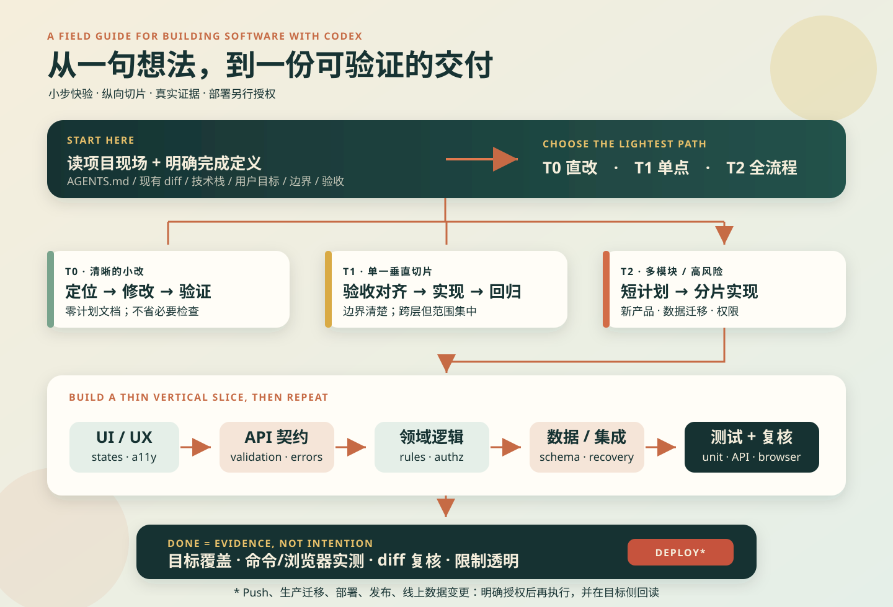
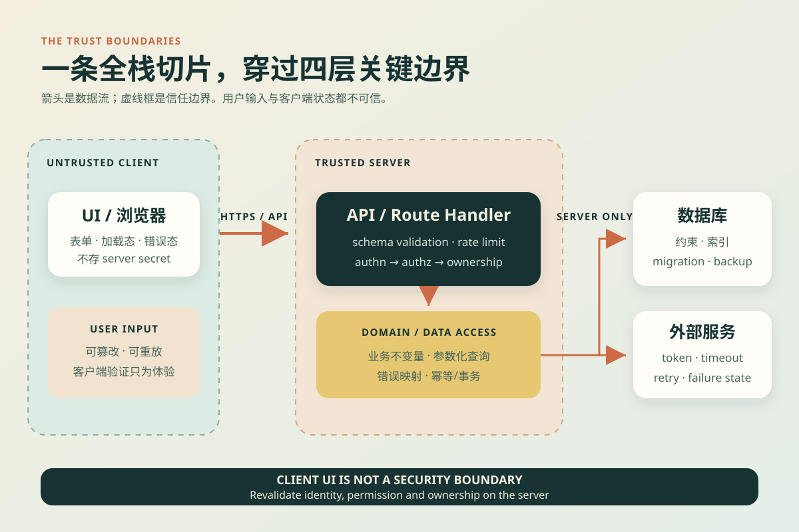
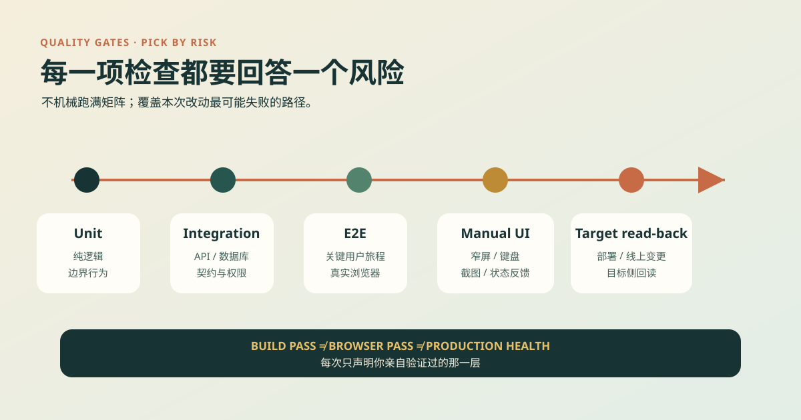

# Codex Vibecoding

独立的 Codex Agent Skill：从需求澄清到 UI、API、数据层、测试与交付。与仓库原有的 `hana-vibecoding` 并存；不含 Hana App、扩展市场、安装器或运行时专属流程。

| 全栈边界 | 按风险选质量门 |
|---|---|
|  |  |

## 使用

可直接解压旁边的 `codex-vibecoding.zip`，或将整个 `codex-vibecoding/` 目录放入 Codex 可发现的技能目录：

- 个人技能：`~/.agents/skills/codex-vibecoding/`
- 当前仓库技能：`<repo>/.agents/skills/codex-vibecoding/`

重新加载技能列表后，可由任务自动匹配，也可显式提及 `$codex-vibecoding`。保留 `SKILL.md` 及其相邻 `references/`、`assets/`、`templates/`；移动时不要只拷入口文件。

## 内容

- `SKILL.md`：T0/T1/T2 分档、先复用后发明，以及必须遵循的协作边界。
- `references/workflow.md`：需求、架构、实现、验证、交付的完整工作流，含优先复用、程序化检查和故障调研顺序。
- `references/fullstack-checklist.md`：前后端、数据、集成、安全、可访问性、性能的按需检查项。
- `references/skill-ecosystem.md`：已核实的优质技能与官方资料索引；只引用，不捆绑第三方 skill。
- `references/principles.md`：先复用后推演、调试、测试、评审、沟通与证据纪律。
- `templates/`：复杂任务的可选目标/验收模板。
- `assets/`：自包含 SVG 流程、架构与质量图。
- `eval/tasks.md`：用于人工检查技能行为的 T0/T1/T2、故障调研与机械检查样例。

该 skill 不指定 Next.js、数据库、云平台或某种测试框架；以目标仓库及用户选择为准。它不代替专业安全审计、架构评审或平台官方文档。
